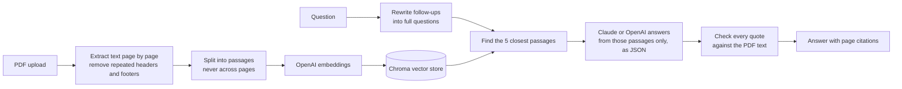

# DocChat: chat with your documents

Ask questions about your PDFs and get short answers that come only from the documents. Every answer shows the file, the page and the exact passage it came from, and you can open the page to check.

**Live demo:** _add your Streamlit link here_

<!-- Add a screenshot of the live app here: save it as docs/screenshot.png and uncomment the line below.

-->

The demo opens with a 16-page employee handbook for **Brightleaf Studio, a fictional design agency**, so you can try it straight away. You can also upload your own PDFs.

## What it does

- **Answers only from your documents.** The model is told to use only the passages it's given. If the answer isn't there, it says so instead of guessing.
- **Cites the page and passage for every claim.** Answers carry markers like [1]. Each marker opens the exact passage and a rendered image of the page.
- **Checks its own quotes.** Before a quote is shown, the app checks it word for word against the PDF text. If the model paraphrased, the app shows the real passage instead and labels it.
- **Handles follow-ups.** "And for part-time staff?" is rewritten into a full question before searching.
- **Works with Claude or OpenAI.** With both keys set, you can switch models from the sidebar.
- **Protects the API bill.** It limits questions per session and per day, the number of uploads, file size and total pages.
- **Comes with an evaluation set.** 15 questions with known answers measure retrieval, answer accuracy, citation accuracy and refusals.

## How it works



Passages never cross a page boundary, which keeps every citation pointing at one exact page.

## Run it locally

You need Python 3.10 or newer and an OpenAI API key. An Anthropic API key is optional: add it to answer with Claude.

**Windows (PowerShell)**

```powershell
cd rag-chatbot
python -m venv .venv
.venv\Scripts\Activate.ps1
pip install -r requirements.txt
copy .env.example .env      # then open .env and paste your keys
streamlit run app.py
```

**macOS / Linux**

```bash
cd rag-chatbot
python3 -m venv .venv
source .venv/bin/activate
pip install -r requirements.txt
cp .env.example .env        # then open .env and paste your keys
streamlit run app.py
```

The app opens at http://localhost:8501.

To work on the interface without API keys, set `RAG_OFFLINE_MODE=1` in `.env`. Answers then come from simple keyword matching, and the app shows a banner saying so.

## Deploy a live demo (free)

1. Push this folder to a public GitHub repository. `.env` is in `.gitignore`, so your keys stay local.
2. Go to [share.streamlit.io](https://share.streamlit.io), choose **Create app**, and pick your repository with `app.py` as the main file.
3. Under **Advanced settings**, choose Python 3.12, and paste your keys into **Secrets** in this format (see `.streamlit/secrets.toml.example`):
   ```toml
   OPENAI_API_KEY = "sk-..."
   ANTHROPIC_API_KEY = "sk-ant-..."
   REPO_URL = "https://github.com/your-name/rag-chatbot"
   ```
4. Deploy, then put the app link at the top of this README.

**Set a monthly spending limit** in your OpenAI and Anthropic dashboards before sharing the link. The app's own limits are a second line of defence.

## Evaluation

```bash
python eval/run_eval.py                     # Claude if its key is set, otherwise OpenAI
python eval/run_eval.py --provider openai
python eval/run_eval.py --provider offline  # keyword baseline, no keys needed
```

The script asks the 15 questions in `eval/questions.json`, 12 with known answers and 3 that the handbook doesn't cover, then scores four checks:

| Check | What it measures |
| --- | --- |
| Retrieval | The page with the answer is among the passages found |
| Answer | The answer contains the expected facts, such as "24" or "31 March" |
| Citation | The answer cites the correct page |
| Refusal | Questions the handbook doesn't cover get "not found", not a guess |

Results are written to `eval/results.md`.

## Tests

```bash
pip install -r requirements-dev.txt
pytest
```

The 21 tests run without API keys. They cover page extraction, footer removal, chunking, quote checking, JSON parsing, refusals and follow-up rewriting.

## Project structure

```
app.py                      Streamlit interface
rag/
  documents.py              PDF loading, footer removal, page-bounded chunking
  store.py                  Chroma vector store wrapper
  providers.py              OpenAI embeddings, Claude and OpenAI chat
  pipeline.py               Follow-up rewriting, retrieval, prompting
  citations.py              JSON parsing and quote checking
  offline.py                Keyword stand-ins for tests and offline mode
  config.py                 Settings and limits from environment variables
data/sample/                Sample handbook PDF (fictional company)
scripts/make_sample_handbook.py   Regenerates the sample PDF
eval/                       Evaluation questions and scoring script
tests/                      pytest suite
```

## Configuration

All settings are environment variables. See `.env.example` for the full list.

| Variable | Default | Purpose |
| --- | --- | --- |
| `OPENAI_API_KEY` | (required) | Embeddings, and answers when OpenAI is picked |
| `ANTHROPIC_API_KEY` | (optional) | Answers with Claude |
| `CLAUDE_MODEL` | `claude-haiku-5-5` | Claude model for answers |
| `OPENAI_MODEL` | `gpt-6.1-terra` | OpenAI model for answers |
| `EMBEDDING_MODEL` | `text-embedding-3-small` | Embedding model |
| `TOP_K` | `5` | Passages sent to the model per question |
| `MAX_QUESTIONS_PER_SESSION` | `25` | Questions per browser session |
| `MAX_QUESTIONS_PER_DAY` | `300` | Questions per day across all visitors |
| `MAX_UPLOAD_FILES` / `MAX_UPLOAD_MB` / `MAX_UPLOAD_PAGES` | `3` / `10` / `80` | Upload limits |

## Limits and next steps

- Scanned PDFs without a text layer are rejected with a message. Adding OCR would let them work.
- Uploaded documents live in memory for the browser session only. A client version would store them in a persistent database such as Supabase pgvector, with a login.
- Possible additions: hybrid keyword and vector search, reranking, streaming answers, and Word or web-page sources.

