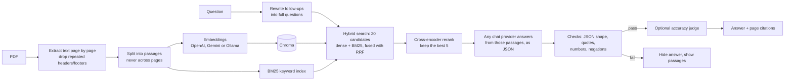

# Sourced: chat with your documents, with citations you can check

Ask questions about your PDFs and get short answers drawn only from the documents. Every answer shows the file, the page and the exact passage behind it, and the app refuses to show answers it can't back up.

**Live demo:** _add your Streamlit link here_

<!-- Add a screenshot of the live app here: save it as docs/screenshot.png and uncomment the line below.

-->

The demo opens with a 16-page employee handbook for **Brightleaf Studio, a fictional design agency**, so you can try it straight away. You can also upload your own PDFs.

## Highlights

| | |
| --- | --- |
| **Five AI providers, one interface** | OpenAI, Anthropic (Claude), Google Gemini, GroqCloud and Ollama (fully local). Mix and match: one provider for search, another for answers. |
| **Hybrid search + reranking** | Keyword search (BM25, written from scratch) and meaning-based search, fused with Reciprocal Rank Fusion, then reordered by a local cross-encoder. Right page in the top 5 for **100%** of test questions, and ranked first for every one of them (**MRR 1.00**). |
| **Reads tables properly** | PDF tables usually come out as run-on text. Sourced rebuilds each row with its column header ("Lead, Principal and Director roles \| Notice required — 8 weeks"), which raised every search method's ranking. |
| **Fail-closed citations** | Quotes are checked against the PDF, and every number in an answer must appear in a cited source. Answers that fail are hidden and the closest passages are shown instead. |
| **Accuracy judge** | An optional second model checks each claim against its passages. It caught **33 of 33** deliberately tampered answers. |
| **Measured, not guessed** | A 35-question evaluation in 7 categories, a free retrieval comparison, a tamper test for the judge, and **137 automated tests**. |
| **Can run free and private** | With Ollama, everything runs on your own computer: no API keys, no cost, no data leaving the machine. |

## How it works



**The answer contract.** The model must reply with JSON: an answer with `[n]` markers, a quote for each source, and a `coverage` of `full`, `partial` or `none`. "Partial" lets the model say "the documents give a rule, not the exact figure" without having to choose between a guess and a refusal.

**Reading tables.** PDF readers usually turn a table into run-on text ("…After probation 4 weeks Lead, Principal and Director roles 8 weeks"), and neither the search nor the model can tell which value belongs to which row. Sourced reads each page twice: normally, for the text, and in pypdf's layout mode, which keeps wide gaps between columns. Lines with those gaps are recognised as table rows and rewritten with their column header:

```
Lead, Principal and Director roles | Notice required (either side) — 8 weeks.
```

Rows are never split between passages, and ordinary text, footers and multi-column pages are left as they were.

**The checks, in order:**
1. **Shape:** malformed JSON gets one retry, then is refused.
2. **Sources exist:** a marker like `[7]` must point at a passage the model was actually given.
3. **Quotes are real:** each quote must be in its source. Models often quote loosely (joining pieces with "...", rebuilding table rows, skipping a sentence), so pieces are checked separately. A changed number, an added or dropped "not", or an invented phrase still fails.
4. **Numbers are grounded:** every number in the answer must appear in a source the answer cites.
5. **Judge (optional):** a second model checks that each claim matches its passages: the right number on the right claim, the right table row, the right condition.

## Results

All results use the fictional handbook, measured in November 2026. AI answers vary from run to run, so end-to-end scores are given as ranges.

### Retrieval: which search finds the right page? (no AI calls, free to reproduce)

`python eval/run_eval.py --retrieval-only` on the 26 answerable, non-follow-up questions, with `nomic-embed-text` embeddings and top 5 passages. "Right page in top 5" / MRR (1.00 = the right page is always ranked first):

| Search | Tables as run-on text | With table reading (current) |
| --- | --- | --- |
| Dense (meaning only) | 96% / 0.88 | 100% / 0.96 |
| BM25 (keywords only) | 100% / 0.93 | 100% / 0.94 |
| Hybrid (dense + BM25, RRF) | 100% / 0.90 | 100% / 0.98 |
| Dense + rerank | 100% / 0.96 | 100% / 1.00 |
| **Hybrid + rerank (default)** | **100% / 0.96** | **100% / 1.00** |

- **Hybrid search** fixed the one question dense search missed ("I'm a Director and I'm resigning…"), where the exact word "Director" matters.
- **Reranking** moved the right page to rank 1 far more often.
- **Reading tables row by row** helped every method. The "Director" row now carries its own context ("Notice required — 8 weeks"), so it is found and ranked on its own merits instead of being buried at the end of a page about probation.
- BM25 alone does well here because this handbook is small and the questions reuse its wording. Hybrid is the default because real users often phrase things in words the documents don't use.

### End to end: 35 hard questions

`python eval/run_eval.py --provider ollama` (local `qwen3.6:35b-a3b`, `nomic-embed-text`, hybrid + rerank):

| Check | Result |
| --- | --- |
| Fully correct (right facts and right page, or a correct refusal) | 35 / 35 on both runs since table reading (34–35 before) |
| Right page found (Hit@5) / MRR | 100% / 1.00 |
| Correct answers wrongly blocked by the checks | 0 |

The 35 questions cover 7 categories: basic facts, exceptions hidden in tables, paraphrases ("my laptop got nicked"), exact terms, multi-part questions, follow-ups that need conversation history, and near-misses where the topic exists but the detail doesn't. GroqCloud (`gpt-oss-120b`) scored in the same range.

### The accuracy judge

`python eval/run_eval.py --provider ollama --judge groq --tamper` (answers from Ollama, judged by a different model on Groq):

| Check | Result |
| --- | --- |
| Tampered answers caught (a number swapped for another from the same passage) | 33 / 33 |
| Correct answers approved | 7 / 7 on the latest run (27 / 29 before tightening the judge's instructions) |

A swapped number from the same passage is exactly the error the deterministic checks can't see, because the number *does* exist in the source. Since these runs, the judge also sees every retrieved passage (not only the cited ones), so it can catch an answer that wrongly says "the documents don't give this"; re-run the command above to refresh these numbers.

## Run it locally

You need Python 3.10 or newer. Pick any setup below; they can be combined.

```powershell
# Windows (PowerShell)
git clone https://github.com/Nijenth/sourced.git
cd sourced
python -m venv .venv
.venv\Scripts\activate
pip install -r requirements.txt
copy .env.example .env      # then open .env and fill in the setup you chose
streamlit run app.py
```

```bash
# macOS / Linux
git clone https://github.com/Nijenth/sourced.git
cd sourced
python3 -m venv .venv && source .venv/bin/activate
pip install -r requirements.txt
cp .env.example .env        # then edit .env
streamlit run app.py
```

The app opens at http://localhost:8501. The reranker downloads a small model (about 80 MB) the first time.

### Choose providers

| Setup | Put in `.env` | Cost | Notes |
| --- | --- | --- | --- |
| **Fully local** | `OLLAMA_MODEL=<a model from ollama list>`<br>`EMBEDDING_PROVIDER=ollama` | Free | Install [Ollama](https://ollama.com), then `ollama pull nomic-embed-text`. Private; speed depends on your hardware. |
| **Free cloud demo** | `GROQ_API_KEY=...`<br>`GEMINI_API_KEY=...`<br>`EMBEDDING_PROVIDER=gemini` | Free tiers | Groq answers fast; Gemini does search. Free tiers have daily limits, and Google may use free-tier data to improve its products: don't use real client documents. |
| **Premium** | `OPENAI_API_KEY=...` and/or `ANTHROPIC_API_KEY=...` | Pay as you go | OpenAI covers search and answers; Claude answers only (Anthropic has no embeddings API). |
| **No AI at all** | `RAG_OFFLINE_MODE=1` | Free | Keyword stand-ins for working on the interface and running tests. |

Every provider with a key appears in the model picker. `CHAT_PROVIDER` chooses which comes first. Changing `EMBEDDING_PROVIDER` re-indexes the documents automatically.

### Run the Sourced API

The milestone M1 API runs locally on Python 3.12 with the fictional Brightleaf Studio handbook. It builds the index in memory on the first chat request. The sample API has no authentication.

```powershell
pip install -r backend/requirements.txt
$env:RAG_OFFLINE_MODE = "1"
python -m uvicorn backend.app.main:app
```

On macOS or Linux, run `RAG_OFFLINE_MODE=1 python -m uvicorn backend.app.main:app` after installing the requirements.

Open the interactive API docs at `http://127.0.0.1:8000/docs`. `GET /api/v1/health` checks liveness. `GET /api/v1/providers` lists chat providers and their configuration status. Try `POST /api/v1/chat` with this JSON body.

```json
{"question": "How many days of annual leave do I get?", "provider": "offline"}
```

`provider` defaults to the first configured provider. Omit `document_ids` or send `["brightleaf-handbook"]` to search the sample. `history` accepts up to six recent `user` or `assistant` messages with a `content` field. The API returns page numbers in citations and leaves `preview_url` null in M1.

To use a configured AI provider, start Uvicorn with the provider settings in the environment and offline mode disabled. Set `RERANKER=none` to skip loading the cross-encoder model.

## Deploy a live demo (free)

1. Push this folder to a public GitHub repository. `.env` is in `.gitignore`, so your keys stay local.
2. Go to [share.streamlit.io](https://share.streamlit.io), choose **Create app**, and pick your repository with `app.py` as the main file.
3. Under **Advanced settings**, choose Python 3.12, and paste your settings into **Secrets** (see `.streamlit/secrets.toml.example`). Ollama can't run there, so use the free cloud setup:
   ```toml
   GROQ_API_KEY = "gsk_..."
   GEMINI_API_KEY = "..."
   EMBEDDING_PROVIDER = "gemini"
   ALLOW_UPLOADS = "off"      # a public link offers only the fictional handbook
   REPO_URL = "https://github.com/Nijenth/sourced"
   ```
4. Deploy, then put the app link at the top of this README.

**Set spending limits** in your provider dashboards before sharing the link. The app's question and upload limits are a second line of defence.

## Evaluation

```bash
python eval/run_eval.py --provider ollama                     # full 35-question run
python eval/run_eval.py --retrieval-only                      # compare search methods, no AI calls
python eval/run_eval.py --provider groq --delay 3             # free tiers: pause between questions
python eval/run_eval.py --provider ollama --category followup # one category only
python eval/run_eval.py --provider ollama --judge groq --tamper  # test the accuracy judge
```

Other options: `--retrieval dense|bm25|hybrid`, `--rerank none|cross-encoder`. When an answer is blocked, the output shows the model's raw reply and the reason, so you can see whether the block was right. Reports are written to `eval/results.md` and `eval/ablation.md`.

### When an answer looks wrong

```bash
python scripts/search.py "your question"            # what each search method retrieved, with scores
python scripts/search.py "your question" --page 4   # ...plus exactly how page 4 is stored
python scripts/inspect_pdf.py 4                     # how the PDF reader sees page 4, line by line
```

These two scripts found the table problem above: the right page *was* retrieved, but its table had been flattened into text the model couldn't read.

In the app, a follow-up question is rewritten into a full question before searching; when that changes the wording, the answer shows "Searched for: …", so a reinterpretation is never silent.

## Tests

```bash
pip install -r requirements-dev.txt
pytest
```

137 tests, no API keys needed: PDF handling and table reading, chunking, BM25 and rank fusion, reranking, every provider adapter (against fake clients), the citation checks (including real quotes the models gave that were once wrongly rejected), the judge, and the evaluation's own scoring rules. One test is marked as an expected failure: it documents a known limitation (below), and pytest will flag it if that limitation is ever fixed.

## Project structure

```
app.py                       Streamlit interface
rag/
  providers/                 One adapter per provider, behind a shared interface
    base.py                  The contracts (Embedder, ChatModel) and error handling
    registry.py              Picks providers from settings
    openai_provider.py  anthropic_provider.py  gemini_provider.py
    groq_provider.py    ollama_provider.py
  documents.py               PDF loading, header/footer removal, page-bounded chunking
  lexical.py                 BM25 keyword search and Reciprocal Rank Fusion
  store.py                   Dense, BM25 and hybrid search
  rerank.py                  Cross-encoder reranking
  pipeline.py                Follow-up rewriting, retrieval, prompting, retry
  citations.py               Answer parsing and the fail-closed checks
  judge.py                   Accuracy judge and the tamper helper
  incident.py                Sample-mode incident report draft (a template, no AI)
  offline.py                 Keyword stand-ins for tests and offline mode
  config.py                  App settings and limits
eval/                        35 questions, scoring script, reports
tests/                       pytest suite
data/sample/                 Sample handbook (fictional company)
scripts/search.py            Debug: what each search method retrieves for a question
scripts/inspect_pdf.py       Debug: how the PDF reader sees a page
scripts/make_sample_handbook.py   Regenerates the sample PDF
```

## Configuration

All settings are environment variables; `.env.example` lists every one with comments.

| Variable | Default | Purpose |
| --- | --- | --- |
| `OPENAI_API_KEY`, `ANTHROPIC_API_KEY`, `GEMINI_API_KEY`, `GROQ_API_KEY` | (none) | Turn on each cloud provider |
| `OLLAMA_MODEL` | (none) | Turns on Ollama with this chat model |
| `EMBEDDING_PROVIDER` / `EMBEDDING_MODEL` | first one set up / provider's default | Who indexes the documents |
| `CHAT_PROVIDER` | (none) | Which provider is first in the picker |
| `RETRIEVAL_MODE` | `hybrid` | `hybrid`, `dense` or `bm25` |
| `RERANKER` / `RERANK_POOL` | `cross-encoder` / `20` | Reranking, and how many candidates it reorders |
| `JUDGE` / `JUDGE_PROVIDER` / `JUDGE_ACTION` | `off` / same as chat / `warn` | Accuracy judge; `block` hides answers judged unsupported |
| `TOP_K` | `5` | Passages sent to the model per question |
| `MAX_QUESTIONS_PER_SESSION` / `MAX_QUESTIONS_PER_DAY` | `25` / `300` | Usage limits for a public demo |
| `ALLOW_UPLOADS` | `on` | `off` for a public demo: only the fictional handbook is offered |
| `MAX_UPLOAD_FILES` / `MAX_UPLOAD_MB` / `MAX_UPLOAD_PAGES` | `3` / `10` / `80` | Upload limits |

Per-provider models and options (`OPENAI_MODEL`, `GEMINI_MODEL`, `GROQ_MODEL`, `OLLAMA_THINK`, and so on) are documented in `.env.example`.

## Known limitations

Being clear about what the checks do and don't guarantee:

- **Stitched quotes prove each piece exists, not that the pieces belong together.** Models often join parts of a passage with "..." or rebuild a table row in their own order. Each piece must be in the source, but the checks can't confirm they were joined correctly.
- **Inside a table, a value swapped for another value from the same table can pass the quote and number checks.** This is documented as an expected-failure test. The accuracy judge catches this kind of error (33/33 in the tamper test), but it's optional and is a model itself.
- **The judge is a model and can be wrong,** and it's more lenient when judging its own answers. Use a different provider for judging, and treat its verdict as a strong signal, not proof.
- **Answers sometimes address a related question.** For example, "What's the stock price?" can get "the documents don't give one; Brightleaf doesn't offer stock options." A relevance check in the judge is a natural next step.
- **Table detection relies on visible column gaps.** Tables drawn as images, or with columns too close together, are still read as plain text; cells that wrap onto several lines may not be rebuilt cleanly.
- **Section headings run into the next sentence** in stored passages (e.g. "Annual leave Full-time employees get…"), because headings have no full stop. Harmless for search and answers; slightly untidy in the quote box.
- **Follow-up rewriting can reinterpret what you typed** (e.g. it read "Dictator" as "Director" from the previous question). The app shows "Searched for: …" whenever this happens.
- **Calculated numbers are blocked.** "12 months × $40 = $480" is refused because 480 isn't in the source.
- **The benchmark is small.** 35 questions on one 16-page fictional handbook. With so few passages, reranking 20 candidates covers about half the document, which flatters the rerank results. Results on large real document sets will differ.
- **Uploads live in memory for one browser session.** There are no user accounts. A client deployment would need login, per-user document storage and deletion before accepting private files.
- **Scanned PDFs without a text layer** are rejected. OCR would let them work.
- **Uploaded text is sent to the chosen AI provider** unless you use Ollama. The upload box says which provider receives it. Check each provider's data-retention terms before using real documents, and set `ALLOW_UPLOADS=off` for a public link.

## What's next

- A relevance check in the judge ("does this answer the question asked?").
- Persistent per-user storage with login (e.g. Postgres with pgvector).
- A React + FastAPI version with accounts and private per-user documents, on the same `rag/` engine (the engine has no Streamlit code in it). The plan is in [`docs/fullstack-brief.md`](docs/fullstack-brief.md).
- Streaming answers, OCR for scanned PDFs, and Word or web-page sources.
